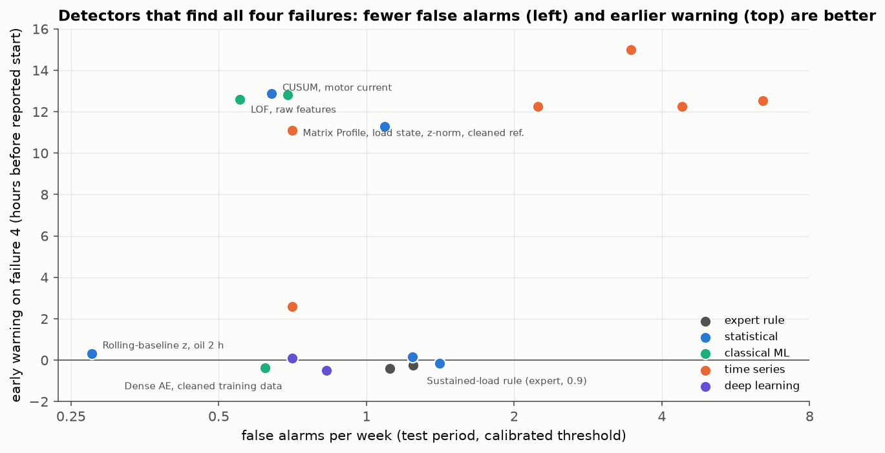

# MetroPT Anomaly Benchmark — Détecter les fuites d'air sur le compresseur d'un métro

[](https://github.com/mimouniahmed/metro-anomaly-benchmark/actions/workflows/tests.yml)

[](LICENSE)

[English](README.md) · **Français**

Comparaison de **34 configurations de détection d'anomalies** issues de cinq familles (règle d'expert, maîtrise statistique des procédés, machine learning classique, méthodes temporelles, deep learning) sur des **données de capteurs industriels réelles** : 7 mois de mesures de l'unité de production d'air d'un train du métro de Porto, avec quatre fuites d'air déclarées. Toutes les méthodes suivent le même protocole : découpage chronologique, seuil calibré uniquement sur l'apprentissage, évaluation par événement.

**Question** : quelle méthode détecte les fuites le plus tôt, avec le moins de fausses alarmes, et la complexité du machine learning en vaut-elle la peine ?

## Résultats clés

| | |
|---|---|
| **Recommandation** | Carte CUSUM sur le courant moteur pour l'alerte précoce, confirmée par un z-score de la température d'huile par rapport aux 7 jours précédents : **4/4 pannes, 0,71 fausse alarme par semaine, panne 4 signalée 12,9 h avant son début déclaré** |
| **Meilleurs détecteurs** | 18 configurations sur 34 détectent les quatre pannes. Les meilleures de chaque famille font 0,3 à 0,8 fausse alarme par semaine ; les deux détecteurs statistiques tournent en moins d'une demi-seconde sur un seul signal chacun |
| **Complexité** | Le machine learning et le deep learning égalent les détecteurs statistiques sans les battre, au prix de graines aléatoires, de temps d'entraînement et d'un jeu d'apprentissage nettoyé |
| **Leçon principale** | Les fuites non déclarées dans les données d'apprentissage comptent plus que l'algorithme : elles aveuglent le Matrix Profile (0/4) et les autoencodeurs (1 à 2/4) tant qu'on ne les retire pas, et ont offert à LOF un succès qu'il perd une fois qu'elles sont retirées |
| **Incertitude** | Avec quatre pannes, 4/4 est compatible avec un vrai taux de détection de seulement 40 %, et les intervalles de fausses alarmes des cinq meilleurs détecteurs se chevauchent : seul un classement grossier est établi |



➡️ **[Rapport de synthèse](docs/report.md)** (en anglais : question, protocole, résultats, recommandation, limites)

## Points techniques

- **Comprendre les données avant de modéliser**
  - une mesure toutes les ~10 s, et non 1 Hz comme documenté ;
  - 18 % de la période manquante, 7 jours de valeurs figées ;
  - la signature des pannes (le compresseur ne cycle plus et reste en charge) et sa physique ;
  - 8 épisodes semblables à des fuites absents des rapports de panne.
- **Un protocole qui résiste aux fuites d'information et au hasard**
  - variables sur fenêtres tournées vers le passé, avec un test unitaire qui modifie les données futures ;
  - découpage chronologique, seuils calibrés sur l'apprentissage avec un budget d'alarmes ;
  - métriques par événement avec avance, et niveau de chance calculé pour des alarmes aléatoires.
- **Maîtrise statistique des procédés** : z-scores robustes, T² de Hotelling, cartes EWMA et CUSUM, référence glissante qui divise les fausses alarmes par cinq.
- **ML classique**
  - Isolation Forest, One-Class SVM, LOF, ACP, chacun avec cinq graines ;
  - alarmes expliquées par la décomposition de l'erreur de reconstruction de l'ACP.
- **Méthodes temporelles et deep learning**
  - résidus de prévision (gradient boosting) et Matrix Profile (stumpy, avec nettoyage de la référence) ;
  - autoencodeurs dense et LSTM (PyTorch, arrêt précoce).
- **Diagnostiquer, pas seulement scorer**
  - pourquoi les distances multivariées échouent (une variable à queue lourde) ;
  - pourquoi le plus proche voisin d'une fuite est une fuite ;
  - pourquoi un autoencodeur reconstruit les pannes qu'il a vues ;
  - pourquoi LOF réussissait pour une mauvaise raison.
- **Conclure honnêtement** : intervalles de Clopper-Pearson et de Poisson, simulation de l'effet de sélection sur 34 configurations, analyses de sensibilité séparées du choix des modèles.
- **Ingénierie** : package Python, 32 tests unitaires, intégration continue GitHub Actions, tableaux de résultats sauvegardés par notebook.

## Démarche

| Notebook | Contenu | Résultat principal |
|---|---|---|
| [01 — Données](notebooks/01_data_exploration.ipynb) | Capteurs, échantillonnage, trous, valeurs figées, cycle de fonctionnement, signature des pannes, complétude des étiquettes | Une fuite est une anomalie collective ; les rapports oublient 8 épisodes semblables |
| [02 — Protocole d'évaluation](notebooks/02_evaluation_protocol.ipynb) | Grille à la minute, 18 variables sur fenêtres, découpage chronologique, évaluation par événement, calibration du seuil, niveau de chance | Mesures brutes : 0/4 ; fenêtres de 2 h : 4/4 |
| [03 — Références statistiques](notebooks/03_statistical_baselines.ipynb) | Règle d'expert, z-score robuste, T² de Hotelling, EWMA, CUSUM, z-score à référence glissante | z-score d'huile vs 7 derniers jours : 4/4, 0,28 fausse alarme/semaine ; CUSUM : alerte 12,9 h en avance |
| [04 — ML classique](notebooks/04_classical_ml.ipynb) | Isolation Forest, One-Class SVM, LOF, ACP ; variables brutes ou corrigées de la dérive ; variabilité selon la graine ; explication des alarmes | LOF égale les meilleures cartes sans les battre |
| [05 — Méthodes temporelles](notebooks/05_time_series_methods.ipynb) | Résidus de prévision, Matrix Profile (brut/z-normalisé, référence complète/nettoyée), contrôle croisé du nettoyage sur LOF | Une référence contaminée aveugle le Matrix Profile ; le nettoyage le répare mais pénalise LOF |
| [06 — Deep learning](notebooks/06_deep_learning.ipynb) | Autoencodeurs dense et LSTM, apprentissage complet ou nettoyé, analyse des reconstructions | 1 à 2/4 sur données complètes, 4/4 une fois nettoyées, aucune alerte précoce |
| [07 — Résultats](notebooks/07_results.ipynb) | Les 34 configurations, intervalles de confiance, effet de sélection, robustesse au budget d'alarmes, coût de la complexité, recommandation | CUSUM + z-score d'huile corrigé de la dérive |

Les notebooks, figures et le rapport sont rédigés en anglais.

## Données

**MetroPT-3**, [UCI Machine Learning Repository](https://archive.ics.uci.edu/dataset/791/metropt+3+dataset) (CC BY 4.0). Veloso, B., Ribeiro, R.P., Pereira, P.M., Gama, J. *The MetroPT dataset for predictive maintenance.* Scientific Data 9, 764 (2022).

1,5 million de mesures de février à août 2020, sur 15 signaux :

| Type | Signaux |
|---|---|
| Analogiques (7) | `TP2`, `TP3`, `H1`, `DV_pressure`, `Reservoirs` (pressions, bar), `Oil_temperature` (°C), `Motor_current` (A) |
| Numériques (8) | `COMP`, `DV_eletric`, `Towers`, `MPG`, `LPS`, `Pressure_switch`, `Oil_level`, `Caudal_impulses` |

Étiquettes : quatre fenêtres de fuite d'air issues des rapports de panne de l'exploitant.

## Installation et reproduction

```bash
git clone https://github.com/mimouniahmed/metro-anomaly-benchmark.git
cd metro-anomaly-benchmark
python -m venv .venv && source .venv/bin/activate   # Windows : .venv\Scripts\activate
pip install torch==2.14.1 --index-url https://download.pytorch.org/whl/cpu   # la version CPU suffit
pip install -r requirements.txt
pip install -e .

pytest   # 32 tests
```

Le jeu de données (218 Mo) est téléchargé automatiquement à la première utilisation par `metrobench.data.load()`, puis mis en cache au format Parquet (22 Mo) dans `data/`. Exécutez les notebooks dans l'ordre, de 01 à 07 ; chacun sauvegarde son tableau de résultats dans `results/`, que le notebook 07 rassemble.

## Structure

```
metro-anomaly-benchmark/
├── src/metrobench/
│   ├── data.py         # téléchargement, cache Parquet, trous, valeurs figées, séquences, étiquettes
│   ├── features.py     # grille à la minute et variables sur fenêtres glissantes
│   ├── evaluation.py   # découpage temporel, événements d'alarme, métriques, calibration du seuil
│   ├── baselines.py    # z-score robuste, T² de Hotelling, EWMA, CUSUM, z-score à référence glissante
│   ├── ml.py           # Isolation Forest, One-Class SVM, LOF, ACP, variables corrigées de la dérive
│   ├── timeseries.py   # résidus de prévision, Matrix Profile avec nettoyage optionnel de la référence
│   ├── deep.py         # autoencodeurs dense et LSTM (PyTorch)
│   └── plotstyle.py    # style commun des figures
├── notebooks/          # analyse, 01 → 07
├── results/            # tableaux de résultats par notebook (CSV)
├── tests/              # tests unitaires
├── docs/
│   ├── report.md       # rapport de synthèse (anglais)
│   └── figures/
└── .github/workflows/  # intégration continue
```

## Outils

Python 3.12 · pandas · NumPy · PyArrow · SciPy · scikit-learn · stumpy · PyTorch · Matplotlib · pytest · GitHub Actions

## Auteur

**Ahmed Mimouni** — [github.com/mimouniahmed](https://github.com/mimouniahmed)

## Licence

Publié sous [licence MIT](LICENSE). Le jeu de données MetroPT-3 est distribué par l'UCI sous licence CC BY 4.0 et n'est pas redistribué dans ce dépôt.
