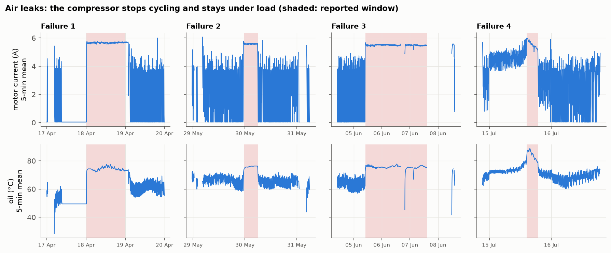

# MetroPT Anomaly Benchmark — Détecter les fuites d'air sur le compresseur d'un métro

[](https://github.com/mimouniahmed/metro-anomaly-benchmark/actions/workflows/tests.yml)

[](LICENSE)

[English](README.md) · **Français**

Comparaison de méthodes de détection d'anomalies sur des **données de capteurs industriels réelles** : 7 mois de mesures de l'unité de production d'air d'un train du métro de Porto, avec quatre pannes documentées (fuites d'air). Les méthodes vont des règles de contrôle statistique au machine learning classique et au deep learning. Toutes tournent sur les mêmes données, avec le même protocole d'évaluation.

**Question** : quelle méthode détecte les fuites le plus tôt, avec le moins de fausses alarmes, et la complexité supplémentaire en vaut-elle la peine ?

> **État** : en cours. Analyse des données terminée (notebook 01) ; méthodes de détection et évaluation à venir.

## Premiers résultats

| | |
|---|---|
| **Signature d'une panne** | Pendant une fuite, le compresseur ne cycle plus et reste **en charge 99,5 % du temps** (contre 15 % normalement), avec une huile **~13 °C plus chaude**. C'est une anomalie *collective* : chaque mesure reste dans la plage normale, la détection doit donc s'appuyer sur des fenêtres de temps et non sur des mesures isolées |
| **Alarme existante** | Le signal de basse pression embarqué ne se déclenche que sur 2,4 % des mesures en panne |
| **Qualité des données** | Une mesure toutes les ~10 s (et non 1 Hz comme documenté) ; 18 % de la période manquante ; 7 jours de valeurs de capteurs figées à exclure |
| **Vérité terrain** | 8 épisodes de charge continue ≥ 1 h ne figurent **pas** dans les rapports de panne : les étiquettes sont incomplètes. L'évaluation se fait donc par événement, et les épisodes non déclarés sont présentés à part |
| **Alerte précoce** | Avant la panne 4, le compresseur était déjà surchargé depuis 14 heures : détecter avant le début déclaré paraît possible |



## Démarche

| Notebook | Contenu | État |
|---|---|---|
| [01 — Données](notebooks/01_data_exploration.ipynb) | Capteurs, échantillonnage, trous, valeurs figées, cycle de fonctionnement, signature des pannes, complétude des étiquettes | ✅ |
| 02 — Protocole d'évaluation | Variables sur fenêtres, découpage temporel, métriques par événement (détection, avance, fausses alarmes par semaine) | prévu |
| 03 — Références statistiques | Règle de charge continue, z-score, cartes de contrôle (EWMA, CUSUM) | prévu |
| 04 — ML classique | Isolation Forest, One-Class SVM, Local Outlier Factor, reconstruction par ACP | prévu |
| 05 — Méthodes temporelles | Résidus de prévision, Matrix Profile | prévu |
| 06 — Deep learning | Autoencodeurs denses et LSTM | prévu |
| 07 — Résultats | Tableau comparatif, coût de la complexité, recommandation | prévu |

Les notebooks et figures sont rédigés en anglais.

## Données

**MetroPT-3**, [UCI Machine Learning Repository](https://archive.ics.uci.edu/dataset/791/metropt+3+dataset) (CC BY 4.0). Veloso, B., Ribeiro, R.P., Pereira, P.M., Gama, J. *The MetroPT dataset for predictive maintenance.* Scientific Data 9, 764 (2022).

1,5 million de mesures de février à août 2020, sur 15 signaux :

| Type | Signaux |
|---|---|
| Analogiques (7) | `TP2`, `TP3`, `H1`, `DV_pressure`, `Reservoirs` (pressions, bar), `Oil_temperature` (°C), `Motor_current` (A) |
| Numériques (8) | `COMP`, `DV_eletric`, `Towers`, `MPG`, `LPS`, `Pressure_switch`, `Oil_level`, `Caudal_impulses` |

Étiquettes : quatre fenêtres de fuite d'air issues des rapports de panne de l'exploitant.

## Installation et reproduction

```bash
git clone https://github.com/mimouniahmed/metro-anomaly-benchmark.git
cd metro-anomaly-benchmark
python -m venv .venv && source .venv/bin/activate   # Windows : .venv\Scripts\activate
pip install -r requirements.txt
pip install -e .

pytest
```

Le jeu de données (218 Mo) est téléchargé automatiquement à la première utilisation par `metrobench.data.load()`, puis mis en cache au format Parquet (22 Mo) dans `data/`.

## Structure

```
metro-anomaly-benchmark/
├── src/metrobench/
│   ├── data.py         # téléchargement, cache Parquet, trous, valeurs figées, séquences, étiquettes
│   └── plotstyle.py    # style commun des figures
├── notebooks/          # analyse, 01 → 07
├── tests/              # tests unitaires
├── docs/figures/
└── .github/workflows/  # intégration continue
```

## Outils

Python 3.12 · pandas · NumPy · PyArrow · scikit-learn · Matplotlib · pytest · GitHub Actions

## Auteur

**Ahmed Mimouni** — [github.com/mimouniahmed](https://github.com/mimouniahmed)

## Licence

Publié sous [licence MIT](LICENSE). Le jeu de données MetroPT-3 est distribué par l'UCI sous licence CC BY 4.0 et n'est pas redistribué dans ce dépôt.
